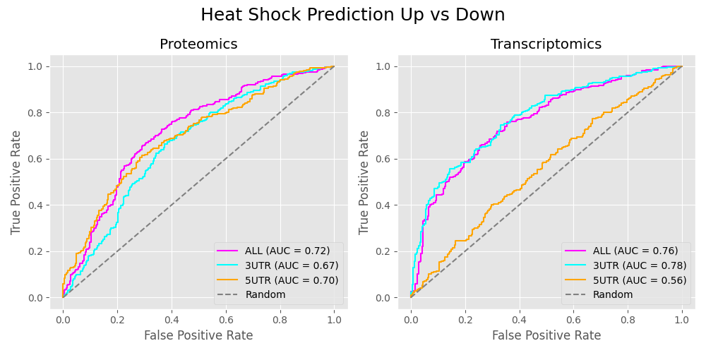
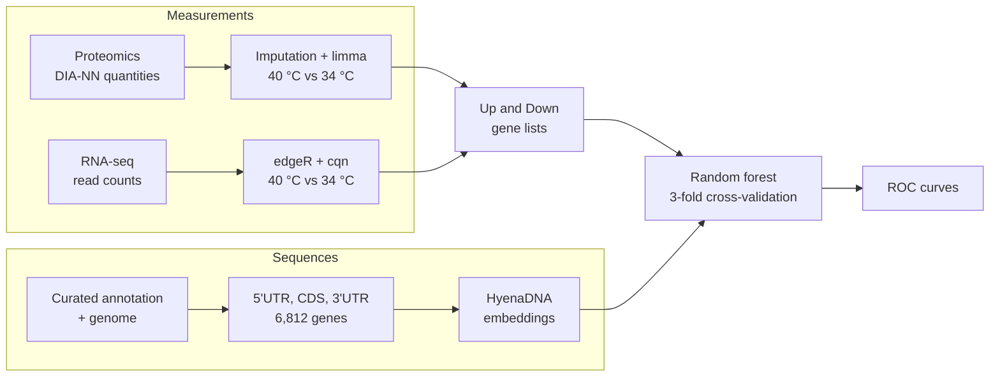

# Heat-shock response of *T. brucei* genes predicted from their UTRs

Code and data for the ROC analysis "Heat Shock Prediction Up vs Down" in the
paper *Thermo-sensing and argonaute-dependent transcriptome remodelling in
trypanosomes*.

The question: can the sequence of a gene's untranslated regions (UTRs)
alone tell whether heat shock will raise or lower that gene's product?
Bloodstream-form *Trypanosoma brucei* (Lister 427) cells were grown at 34 °C and 40 °C
and measured by proteomics and RNA-seq. Genes that went up or down
significantly at 40 °C were collected, and a random forest was trained to
tell the two groups apart using only a numerical description of each
gene's 5′UTR and 3′UTR. The ROC curves show how well it succeeds on genes
it has not seen.



## How the analysis works



1. **Which genes respond to heat.** For each gene the proteomics and RNA-seq
   data give a fold change between 40 °C and 34 °C and a statistical
   significance. Genes clearly higher at 40 °C form the *Up* group and
   genes clearly lower form the *Down* group, separately for protein and
   for mRNA.
2. **Turning sequences into numbers.** HyenaDNA is a DNA language model
   trained on genomes. Given a sequence, it returns 256 numbers that
   summarise it, called an *embedding*. Each gene gets one embedding for its
   5′UTR and one for its 3′UTR.
3. **Prediction.** A random forest learns to separate Up from Down genes
   from the embeddings. The genes are split into three parts. The model is
   trained on two parts and scores the third, in turn, so every gene is
   scored by a model that never saw it.
4. **ROC curve.** The curve shows the true positive rate against the false
   positive rate for all score thresholds. The area under it (AUC) is 0.5
   for random guessing and 1.0 for perfect separation.

`docs/methods.md` gives every step with its parameters.

## Results

| Data | Features | Up | Down | AUC | AUC mean ± SD, 20 repeats |
|---|---|---|---|---|---|
| Proteomics | 5′UTR + 3′UTR | 311 | 283 | 0.72 | 0.735 ± 0.008 |
| Proteomics | 3′UTR | 311 | 283 | 0.67 | 0.672 ± 0.013 |
| Proteomics | 5′UTR | 311 | 283 | 0.70 | 0.703 ± 0.014 |
| Transcriptomics | 5′UTR + 3′UTR | 269 | 242 | 0.76 | 0.762 ± 0.009 |
| Transcriptomics | 3′UTR | 269 | 242 | 0.78 | 0.766 ± 0.009 |
| Transcriptomics | 5′UTR | 269 | 242 | 0.56 | 0.552 ± 0.023 |

The AUC column is the figure (one cross-validation split, seed 42). The last
column repeats the cross-validation with 20 different random splits.

## Reproduce the analysis

You need [Docker](https://docs.docker.com/get-docker/) and about 3 GB of
disk space. On Apple silicon, Docker runs the image in x86-64 emulation,
which is slower but gives the same results.

1. Get the repository:

   ```
   git clone https://github.com/mtinti/thermoresponse_paper.git
   cd thermoresponse_paper
   ```

2. Build the image (about 5 minutes, once):

   ```
   docker build --platform linux/amd64 -t thermoresponse-paper .
   ```

3. Run everything (about 3 minutes):

   ```
   docker run --rm --platform linux/amd64 -v "$PWD":/work thermoresponse-paper make all
   ```

Each step prints `OK` or `FAIL` for its checks. The figure and tables are
written to `results/`:

| Output | Content |
|---|---|
| `results/figure/Heat_Shock_Prediction_Up_VS_Down_ROC.png` (and `.svg`) | The ROC figure |
| `results/figure/auc_up_vs_down.tsv` | AUCs, class sizes, and mean ± SD over 20 repeats |
| `results/figure/ML_results_Up_vs_Down_*.tsv` | Class and prediction for every gene |
| `results/figure_rebuilt/` | The same, drawn from the DE tables recomputed by this run |
| `results/rnaseq/`, `results/proteomics/`, `results/sequences/` | Recomputed intermediate tables |

To run a single step, replace `make all` with one of `make check-data`,
`make rnaseq`, `make proteomics`, `make sequences` or `make figure`.

### What "reproduced" means here

| Step | Check | Result |
|---|---|---|
| Figure | AUCs and the class prediction of every gene against the published ones | identical |
| UTR and CDS sequences | files against the published ones | identical |
| Proteomics differential abundance | fold changes against the published table | identical for the 5,834 proteins without missing values; the 140 proteins with imputed values differ, because the published imputation used an unseeded random draw |
| RNA-seq differential expression | gene lists against the published table | 9,396 genes tested in both; 1 gene at the fold-change cutoff changes group (logFC −0.39992 vs −0.40008), because cqn uses random numbers and the published run had no seed |
| Embeddings | not part of `make all` (needs a GPU) | two independent GPU runs differ by at most 3 × 10⁻⁶ per value |

By default the figure uses the published intermediate tables, which are in
`data/`. `results/figure_rebuilt/` uses the recomputed ones. Its proteomics
AUCs are identical, and its transcriptomics AUCs are 0.76, 0.77 and 0.56.

### Recomputing the embeddings (optional)

The embeddings used in the paper are in `data/embeddings/`. To recompute
them you need an NVIDIA GPU:

```
docker build -f docker/Dockerfile.embeddings -t thermoresponse-embeddings .
docker run --rm --gpus all -v "$PWD":/work thermoresponse-embeddings make embeddings
```

## Repository contents

```
data/        input data, with checksums and a description of each file
scripts/     one script per analysis step, numbered in order, and verify.py
upstream/    how the input data were produced from the raw data
expected/    published outputs used by the checks
docs/        methods and figure
Dockerfile   environment for all steps except the embeddings
Makefile     the commands run by make all
```

## Raw data

| Data | Repository | Accession |
|---|---|---|
| RNA-seq reads (27 samples, BGISEQ paired-end) | NCBI SRA | [PRJNA1381115](https://www.ncbi.nlm.nih.gov/bioproject/PRJNA1381115) |
| Proteomics raw files (18 DIA runs) | PRIDE | [PXD071951](https://www.ebi.ac.uk/pride/archive/projects/PXD071951) |

`upstream/samples_rnaseq.tsv` gives the SRA run of each RNA-seq sample.

`upstream/` describes how the files in `data/` were produced from these raw
data.

## Citation

If you use this code or data, cite the paper and this archive
(see `CITATION.cff`).

## License

Code: MIT (`LICENSE`). Data in `data/` and `expected/`: CC BY 4.0
(`data/LICENSE`).

## Contact

Michele Tinti is responsible for the data and code. Please open a GitHub
issue for questions.
